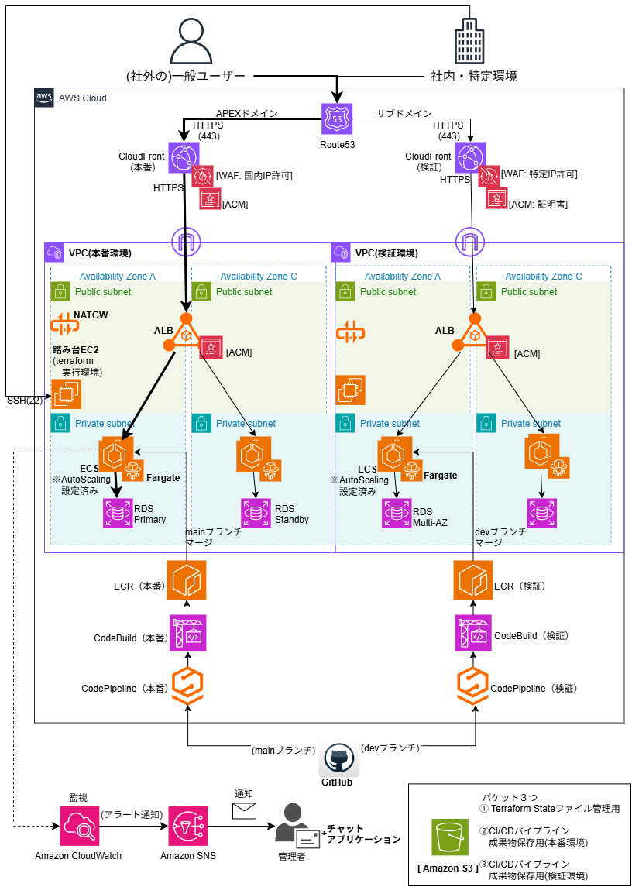

# AWS 3層アーキテクチャ自動構築インフラ（Terraform）

本リポジトリは、AWS上に高可用性とセキュリティを担保したWeb3層構造のインフラ環境を、Terraformを用いて自動構築するためのコードおよび設計ドキュメントです。
実務での運用を想定し、開発環境（dev）と本番環境（prod）を独立したディレクトリ構造で管理しています。

## 🏢 システム構成図


※編集用の元データ（`architecture.drawio`）も同フォルダ内に格納しています。

## 📄 設計・提案ドキュメント
本インフラ構築にあたり、設計からコスト試算まで実務フローに沿ってドキュメントを作成し、`docs/` フォルダ内で一元管理しています。

* [提案書・要件定義書](./docs/proposal.pdf) ：ビジネス背景とインフラの選定基準
* [パラメータシート・詳細設計書](./docs/parameter_sheet.xlsx) ：ネットワーク（CIDR）、インスタンス、セキュリティグループの定義
* [AWS概算見積表](./docs/cost_estimate.xlsx) ：本番・開発環境それぞれの月額運用コスト試算

## 🛠️ 技術スタック
* **Cloud**: AWS (VPC, ALB, EC2, RDS, NAT Gateway, S3, etc.)
* **IaC**: Terraform (v1.x)
* **Architecture**: マルチAZ構成（高可用性）、パブリック/プライベートサブネット分離（セキュリティ）

## ✨ 本構成のこだわり・アピールポイント
1. **環境の完全分離とディレクトリ設計**
   * `dev/` と `prod/` のディレクトリを明確に分けることで、環境間の干渉を防ぎ、安全な構成変更（リソースの増減やインスタンスタイプの変更など）を可能にしています。
2. **本番環境（prod）における高可用性の実現**
   * マルチAZ（Availability Zone）を跨いだ冗長構成を組み、片方のデータセンターで障害が発生してもサービスが継続できる設計にしています。
3. **最小権限の原則に基づくセキュリティ設計**
   * セキュリティグループおよびIAMポリシーは、必要な通信・権限のみを許可するホワイトリスト形式で厳密に定義しています。

## 🚀 実行手順 (Usage)
各環境のディレクトリに移動し、Terraformコマンドを実行します。

```bash
# 開発環境（dev）の構築
cd dev
terraform init
terraform plan
terraform apply

# 本番環境（prod）の構築
cd ../prod
terraform init
terraform plan
terraform apply
```
